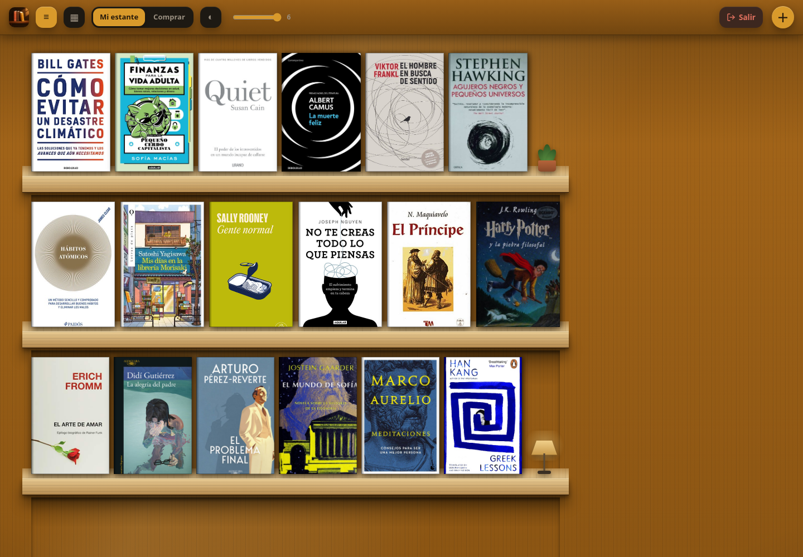
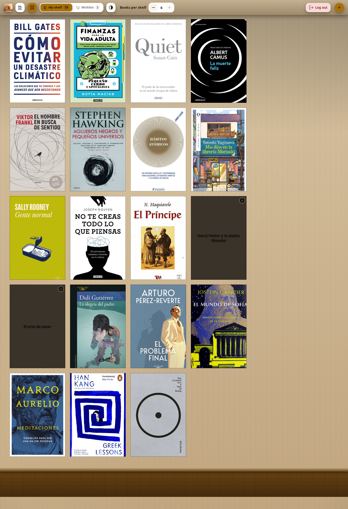
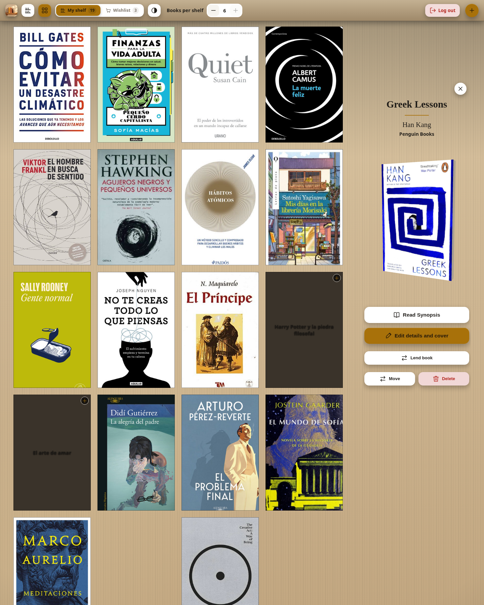
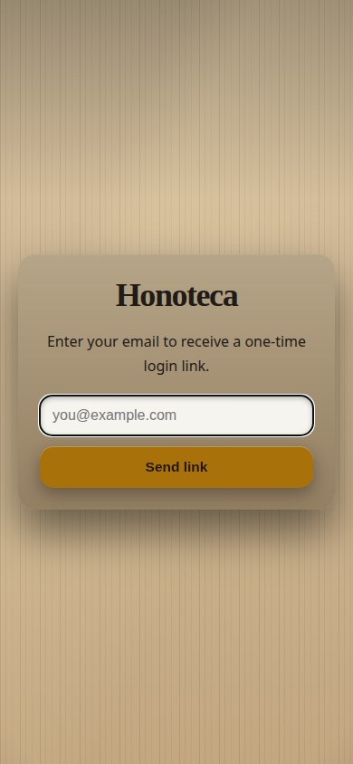

<p align="center">
  
</p>

<h1 align="center">Honoteca</h1>

A physical book library and wishlist app that turns a quick phone photo of a book's barcode or cover into an interactive 3D wooden bookshelf. Built with React, Three.js, Express 5, and built-in Node SQLite.



## Screenshots

| Grid view | Book detail |
| :---: | :---: |
|  |  |

<p align="center">
  
</p>

## Features

- **Photo-to-shelf workflow** — Snap the back barcode (`zxing-wasm` in the browser) or fall back to client-side Spanish/Latin cover OCR (`tesseract.js`) when a barcode isn't readable.
- **Multi-catalog metadata** — Chains openBD, National Diet Library (NDL), Open Library, and Google Books, plus exact-ISBN cover caching from Open Library and El Sótano so cover images never rot.
- **Interactive 3D book & wooden room** — Inspect books as 3D objects (`Three.js`) with spine color extracted from your photo, flippable back-cover synopsis, gyroscope/mouse parallax, and soft shadows.
- **Owned shelf & wishlist** — Separate **Mi estante** (`owned`) and **Comprar** (`buy`) shelves, multiple physical copies per ISBN (`×N`), and shelf/grid views with dark, sepia, and light themes.
- **Passwordless whitelist & per-user libraries** — Magic-link email login (`ALLOWED_EMAILS`) where every whitelisted email gets its own isolated library inside the same SQLite database.
- **Automatic English/Spanish interface** — Uses your browser or phone's language preferences, with English as the fallback. Book titles, publishers, and synopses keep their edition's language.

## Prerequisites

- **Node.js ≥ 22.12** (uses built-in `node:sqlite` and `.env` loader — zero native addons).

## Getting Started

### Local Development (HMR)

Run the API server and the Vite dev server in two terminals:

```sh
npm install
npm run dev:api   # Express API + SQLite on :8849
npm run dev       # Vite HMR on :5173 (proxies /api and /covers to :8849)
```

Open `http://localhost:5173` (or `http://<your-lan-ip>:5173` from your phone on the same Wi-Fi).

> [!TIP]
> When `ALLOWED_EMAILS` is not set in `.env`, authentication is disabled so you can scan books from your phone over LAN without logging in.

### Production (Single Command)

```sh
./start.sh        # Installs deps, vendors OCR assets, builds Vite, and serves on 0.0.0.0:8849
```

## Configuration

Copy `.env.example` to `.env` to configure authentication, email delivery, or storage paths:

| Variable | Description |
| :--- | :--- |
| `ALLOWED_EMAILS` | Comma-separated whitelist of emails allowed to sign in (also accepts `OWNER_EMAIL`). Each email gets its own isolated library. |
| `AUTH_SECRET` | Random secret used to HMAC-sign 30-day session cookies (`openssl rand -hex 32`). |
| `RESEND_API_KEY` | Optional [Resend](https://resend.com) API key to email magic links. If omitted, the 15-minute login link is printed to the server logs. |
| `RESEND_FROM` | Verified sender address in Resend (defaults to `Honoteca <onboarding@resend.dev>`). |
| `DATA_DIR` | Optional directory to store both `library.db` and `covers/` on a single mounted volume (e.g. `/data` on Fly.io). |
| `TRUST_PROXY` | Set to `1` when running behind a reverse proxy (Fly.io, Caddy, nginx) for accurate rate-limiting IPs and HTTPS detection. |
| `GOOGLE_BOOKS_API_KEY` | Optional API key to enable the official Google Books API quota. |

> [!IMPORTANT]
> When `NODE_ENV=production`, the server refuses to start unless `ALLOWED_EMAILS` (or `OWNER_EMAIL`) is set, preventing an unauthenticated public deployment by mistake.

## Deployment (Fly.io + GitHub Actions)

The repository includes `Dockerfile`, `fly.toml`, and `.github/workflows/fly-deploy.yml` for automatic deployments on every push to `main`.

```sh
# 1. Create app and 1GB persistent volume
fly apps create honoteca
fly volumes create honoteca_data --size 1 --region dfw --yes

# 2. Configure secrets
fly secrets set \
  ALLOWED_EMAILS="you@example.com,friend@example.com" \
  AUTH_SECRET="$(openssl rand -hex 32)"

# 3. Deploy
fly deploy --ha=false
```

To enable automatic deploys from GitHub Actions, create a deploy token (`fly tokens create deploy -x 999999h`) and save it as the `FLY_API_TOKEN` repository secret in GitHub.

## Project Structure

```text
├── server/
│   ├── index.js      # Express 5 entrypoint, static asset serving, and production guards
│   ├── auth.js       # Magic-link endpoints, rate limiting, and per-user session middleware
│   ├── session.js    # Stateless HMAC session signing and token hashing
│   ├── api.js        # Book CRUD, scan ticket staging, cover caching, and confirmation flow
│   ├── db.js         # Sealed node:sqlite data layer (WAL mode, per-user isolation)
│   ├── meta.js       # ISBN & title lookup chain (openBD, NDL, Open Library, Google Books)
│   └── upload.js     # Multer disk storage for spine/cover photos and orphan cleanup
├── src/
│   ├── App.jsx       # Scan state machine (states A/B/C/D), shelf/detail layout, and transitions
│   ├── components/   # Cover3D, ShelfView, BookDetail, ConfirmPanel, CropDialog, Login, etc.
│   └── lib/          # Client barcode decoding (zxing-wasm), cover OCR (tesseract.js), spine color
└── scripts/
    └── vendor.mjs    # Self-hosts tesseract.js core and Spanish traineddata into public/vendor/
```

## Scripts

| Command | Description |
| :--- | :--- |
| `npm run dev` | Start Vite dev server with HMR (`:5173`) |
| `npm run dev:api` | Start Express API server (`:8849`) |
| `npm run build` | Build production frontend into `dist/` |
| `npm start` | Start production server serving `dist/`, `/api`, and `/covers` |
| `npm test` | Run backend and pure-function test suite (`node --test`) |
